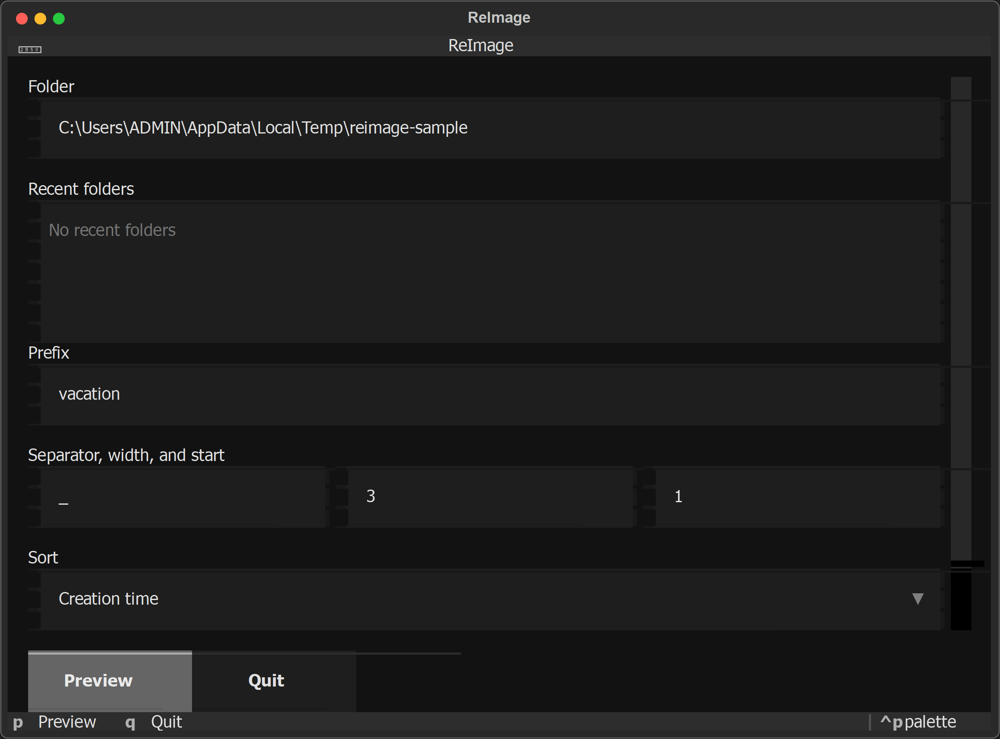
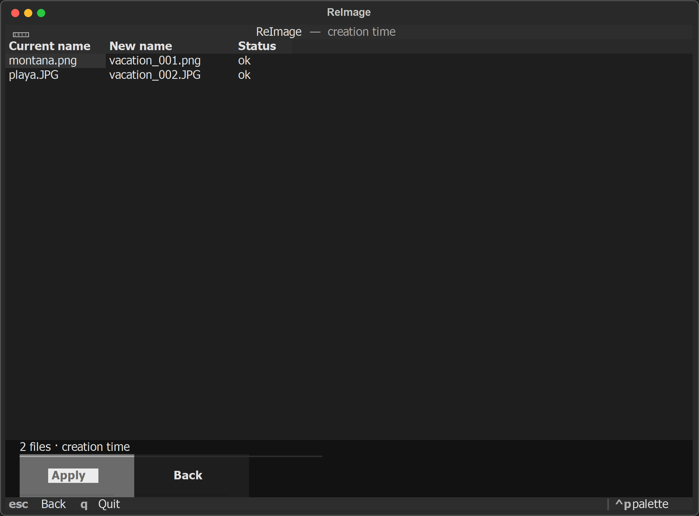

# ReImage

ReImage renombra las imágenes de una carpeta con un prefijo común y una secuencia numérica estable. La interfaz es una TUI: eliges la carpeta, el prefijo, el orden y las extensiones, revisas la tabla `nombre actual → nombre nuevo` y solo entonces se aplican los cambios. Un registro JSON permite deshacer la última ejecución de esa carpeta.

El comportamiento por defecto reproduce el de la herramienta original: extensiones `jpg`, `jpeg`, `png`, `gif`, `bmp` y `tiff`, orden por fecha de creación (de más antigua a más reciente) y nombres `{prefijo}_{001}{extensión}`, conservando las mayúsculas de la extensión. Ejemplo: `vacation_001.JPG`.

## Interfaz

La pantalla inicial pide la carpeta, el prefijo, la secuencia, el orden y las extensiones.



La vista previa muestra el nombre actual, el nombre nuevo y el estado de cada archivo. Apply solo se activa si el plan no tiene colisiones.



## Autor

[HugoFernandoColmenares](https://github.com/HugoFernandoColmenares)

## Requisitos

- Python 3.11 o superior. El desarrollo usa Python 3.13.
- Windows, macOS o Linux.

## Instalación

```bash
python -m pip install -e ".[dev]"
pytest
python -m reimage
```

La guía de instalación está en [`docs/guides/install.md`](docs/guides/install.md). El diseño del programa está en [`docs/guides/ARCHITECTURE.md`](docs/guides/ARCHITECTURE.md).

## Uso

La TUI se abre sin argumentos:

```bash
python -m reimage
```

| Tecla | Acción |
| --- | --- |
| `p` | Construye y abre la vista previa |
| `enter` | Confirma la acción principal enfocada |
| `u` | Deshace la última aplicación de esa carpeta |
| `q` | Sale. Se rechaza mientras un renombrado está en curso. Dentro de un campo de texto la tecla escribe; el botón Quit también cierra |
| `escape` | Vuelve desde la vista previa o el resultado |

Sin interfaz, para scripts y pruebas:

```bash
python -m reimage --folder RUTA --prefix vacation --dry-run
python -m reimage --folder RUTA --prefix vacation --yes
python -m reimage --undo --folder RUTA
```

`--dry-run` imprime el plan y no mueve archivos. `--yes` aplica el plan por defecto e imprime una línea por cada archivo renombrado. Si hay una colisión, no se mueve nada.

## Qué incluye esta versión

- Vista previa antes de renombrar.
- Aviso de colisiones. Aplicar permanece desactivado mientras alguna fila esté marcada.
- Renombrado en dos pasos, dentro de la misma carpeta, para que la numeración pueda intercambiarse sin pisar un archivo de origen.
- Deshacer la última ejecución de cada carpeta. Detalle en [`docs/guides/undo.md`](docs/guides/undo.md).
- Orden por creación, modificación o nombre. Separador, ancho y número inicial configurables.
- Las últimas cinco carpetas, guardadas en el directorio de datos del usuario.
- Ejecutable de consola con PyInstaller. Pasos en [`docs/guides/release.md`](docs/guides/release.md).

Quedan fuera de esta versión las subcarpetas recursivas, el selector de archivos del sistema, arrastrar y soltar, el orden por fecha EXIF, las plantillas libres y la actualización automática.
