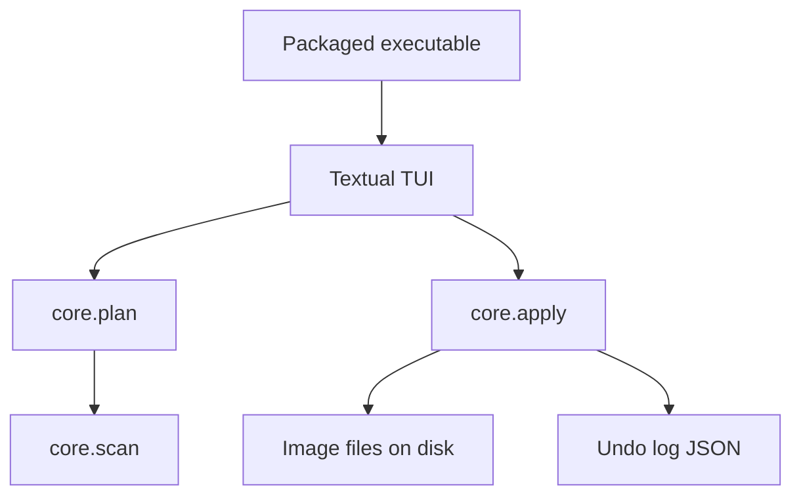

# ReImage — Python MVP

ReImage is a small desktop utility that renames the images in one folder with a shared prefix and a stable numeric sequence. The C# console in `RenameImagesCLI` is the behavior to preserve. The Python port is the product to ship: a text user interface (TUI), a preview before any file moves, and a packaged executable for Windows, macOS, and Linux.

## Summary

Today the program asks for a word, takes a folder path from the first argument or from the keyboard, and renames every `jpg`, `jpeg`, `png`, `gif`, `bmp`, and `tiff` file in that folder. Files are ordered by creation time. The new name is `{word}_{001}{extension}`, keeping the original extension. The rename runs immediately. There is no preview, no undo, and no packaged binary that runs without a .NET runtime.

The MVP keeps that outcome and puts a confirmation step in front of it. The user sets the folder, the prefix, the sort order, and the extensions, reviews a table of `current name → new name`, and only then applies the rename. A JSON log makes the last run reversible.

## Architecture

The rename rules live in a library with no terminal code. The TUI and the future executable are thin shells over that library. Guides and screenshots live under `docs/` so the product description stays next to the code and out of the C# tree.

```
ReImage/
├── RenameImagesCLI/          # Existing C# console. Kept until the Python port matches it.
├── docs/
│   ├── guides/               # Shorter task guides (build, release, undo).
│   │    └── ARCHITECTURE.md  # This guide.
│   └── screenshots/          # TUI captures used by the guides. PNG, one feature per file.
├── src/
│   └── reimage/
│       ├── __main__.py       # `python -m reimage`
│       ├── app.py            # Textual application and screen flow.
│       ├── screens/          # Setup, preview, result.
│       ├── core/
│       │   ├── scan.py       # Discover images and read sort keys.
│       │   ├── plan.py       # Build the rename plan and detect collisions.
│       │   └── apply.py      # Rename through a temporary name, write the undo log.
│       └── models.py         # Plan, RenameItem, Settings.
├── tests/
├── pyproject.toml
└── packaging/
    └── reimage.spec          # PyInstaller spec shared by the three platform builds.
```

`docs/guides/` holds how-to pages written after a flow exists (how to build the executable, how undo works). `docs/screenshots/` holds the matching captures: setup screen, preview with a collision, and the result screen. File names use the screen id, for example `setup.png` and `preview-collision.png`.

### Layers



- **core** decides the plan and performs the rename. It does not print, draw widgets, or read `argv`.
- **app** collects settings, renders the plan, and calls `apply` after an explicit confirm.
- **packaging** freezes `python -m reimage` into a per-platform executable. It does not change rename behavior.

### Rename pipeline

1. **Scan.** List files in the chosen folder whose extension is in the allowed set. The default set matches the C# program: `.jpg`, `.jpeg`, `.png`, `.gif`, `.bmp`, `.tiff`. Matching is case-insensitive. The scan is not recursive in the MVP.
2. **Sort.** Default order is creation time, oldest first, which is what `File.GetCreationTime` does on Windows today. On Windows and macOS the implementation reads birth time. On Linux, where birth time is often missing, the scan uses modification time and the preview labels the key so the user sees which clock was used.
3. **Plan.** New names follow `{prefix}{separator}{number}{extension}`. Defaults reproduce the current output: separator `_`, number width `3`, first number `1`, original extension preserved including its case. Example: `vacation_001.JPG`.
4. **Collisions.** The plan flags a row when the target name already exists and that existing file is not itself part of the batch. Two files in the batch that would land on the same name are also flagged. Apply stays disabled while any row is flagged.
5. **Apply.** Each file is moved to a temporary name in the same folder, then to the final name. That two-step move avoids the case where `a_002.jpg` must become `a_001.jpg` while `a_001.jpg` still occupies the target. The undo log is written before the first successful move and updated after each one.
6. **Undo.** The log stores absolute paths of the original name and the new name. Undo walks the log in reverse and moves files back. A later MVP run replaces the log for that folder only after the user confirms.

The C# project stays in the repository until the Python scan, plan, and apply tests cover the same extensions, sort, and `{prefix}_{001}{ext}` pattern.

## Python libraries

Runtime target: **Python 3.13**, already installed on the development machine. The package declares `requires-python >= 3.11` so the same source builds on current Windows, macOS, and Linux interpreters.

| Library | Role | Shipped in the app |
| --- | --- | --- |
| Textual | TUI: screens, tables, inputs, key bindings, layout | Yes |
| platformdirs | Per-user path for settings and the last undo log | Yes |
| pytest | Unit tests for scan, plan, collision, and undo | No |
| PyInstaller | Freeze the TUI into an executable | No |

The standard library covers the rest: `pathlib`, `dataclasses`, `json`, `argparse`, and `tempfile`. Image decoding is out of scope, so Pillow is not a dependency. Rich is not listed on its own; Textual already uses it.

Versions are pinned in `pyproject.toml` to the current stable releases at implementation time. Development dependencies live in an optional `dev` extra:

```toml
[project]
name = "reimage"
requires-python = ">=3.11"
dependencies = [
  "textual",
  "platformdirs",
]

[project.optional-dependencies]
dev = ["pytest", "pyinstaller"]

[project.scripts]
reimage = "reimage.app:main"
```

## TUI

The interface is a Textual app with three screens. The palette stays on Textual’s default dark theme so the MVP does not carry a custom design system. Spacing, a single header, and a footer of key hints are enough to feel finished.

### Setup

- Folder path. The field accepts a pasted path. A recent-folders list (last five, stored with `platformdirs`) fills the field on Enter.
- Prefix. Required. Leading and trailing spaces are stripped. Characters that are illegal in Windows file names (`\ / : * ? " < > |`) are rejected in the field.
- Separator, number width, and start index. Defaults `_`, `3`, and `1`.
- Sort: Creation time, Modification time, Name.
- Extension checklist with the six historical types turned on.
- Primary action: **Preview**. It is enabled when the folder exists and the prefix is valid.

### Preview

A table with three columns: current name, new name, status (`ok` or the collision reason). The footer shows the file count and the sort key that was actually used. **Apply** runs the plan. **Back** returns to Setup with the fields intact. Apply is disabled when the plan is empty or any row is a collision.

### Result

A short summary: renamed, skipped, failed. Failures stay on screen with the exception message for that file. **Undo** is available when a log was written. **Close** returns to Setup.

### Keys

| Key | Action |
| --- | --- |
| `p` | Build and open the preview |
| `enter` | Confirm the focused primary action |
| `u` | Undo the last apply for this folder |
| `q` | Quit. Quit is refused while an apply is running |
| `escape` | Back from Preview or Result |

The first screen paints a header `ReImage`, the folder and prefix fields, and a footer `p Preview   q Quit`. That is the capture stored as `docs/screenshots/setup.png` once the screen exists.

Headless runs stay available for tests and scripts: `python -m reimage --folder PATH --prefix WORD --yes` applies the default plan without the TUI and prints one line per rename. `--dry-run` prints the plan and writes nothing.

## MVP features

These are the features that make the port a product someone else can run, not only a translation of `Program.cs`.

1. **Parity with the C# tool.** Same default extensions, creation-time order, and `{prefix}_{001}{ext}` names.
2. **Preview before rename.** Nothing is moved until the user confirms the table.
3. **Collision report.** The preview explains which names would overwrite a file outside the batch, and Apply stays off until the plan is clean.
4. **Safe apply.** Two-step rename inside the folder so numbering can shift without clobbering a source file.
5. **Undo.** One JSON log per folder, reversible from the Result screen and from `python -m reimage --undo`.
6. **Sort and sequence controls.** Creation time, modification time, or name. Configurable separator, width, and start index, with the historical values as defaults.
7. **Recent folders.** The last five folders, so the common case does not need a file dialog.
8. **Clear failures.** A locked or missing file is reported on its own row. Files already renamed stay renamed. The log records only the moves that succeeded, and undo restores those.
9. **Cross-platform executable.** A windowless console program named `reimage` on macOS and Linux and `reimage.exe` on Windows, built with PyInstaller on each OS.
10. **Guides and screenshots.** `docs/guides/` documents install-from-source, the executable, and undo. `docs/screenshots/` holds the three screen captures those guides refer to.

### Explicitly later

Recursive subfolders, a native OS file picker, drag and drop, EXIF date sorting, custom format templates, batch profiles, and an auto-update channel. They are real follow-ups. They are not required for the first packaged release.

## Cross-platform executable

PyInstaller freezes the interpreter, Textual, and `reimage` on the OS where the build runs. It does not cross-compile. A Windows `.exe` is built on Windows, a macOS binary on macOS, and a Linux binary on Linux. Each artifact is a one-folder bundle (`onedir`). One-folder builds start faster and avoid Textual’s packaged CSS being unpacked on every launch. The bundle layout is:

```
dist/
├── windows/reimage/reimage.exe
├── macos/reimage/reimage
└── linux/reimage/reimage
```

The spec file calls `collect_all("textual")` so CSS and widget assets ship inside the bundle. The executable is a console app, because a TUI needs a terminal. Users start it by opening the binary in a terminal, or by a small launcher script next to it.

Release steps, to be copied into `docs/guides/release.md` when the spec exists:

1. `python -m pip install -e ".[dev]"`
2. `pytest`
3. `pyinstaller packaging/reimage.spec`
4. Run the binary, open Setup, preview a folder of sample images, apply, undo, and quit.
5. Save the three screen captures under `docs/screenshots/`.

A later CI job can run those steps on three runners. The MVP only requires that a maintainer can produce the bundle on each OS from the same spec file.

The executable does not include the C# build. After the Python tests match the current rename rules, `RenameImagesCLI` can be removed in a separate change.
